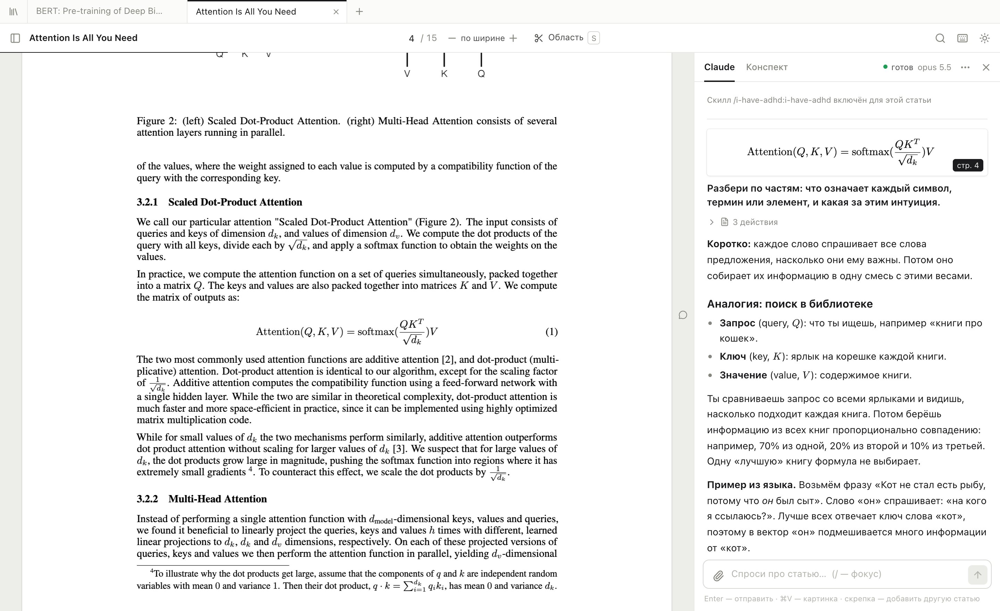
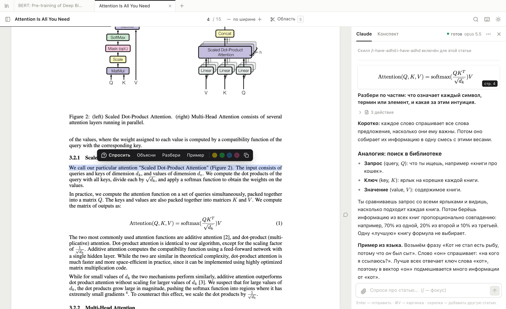
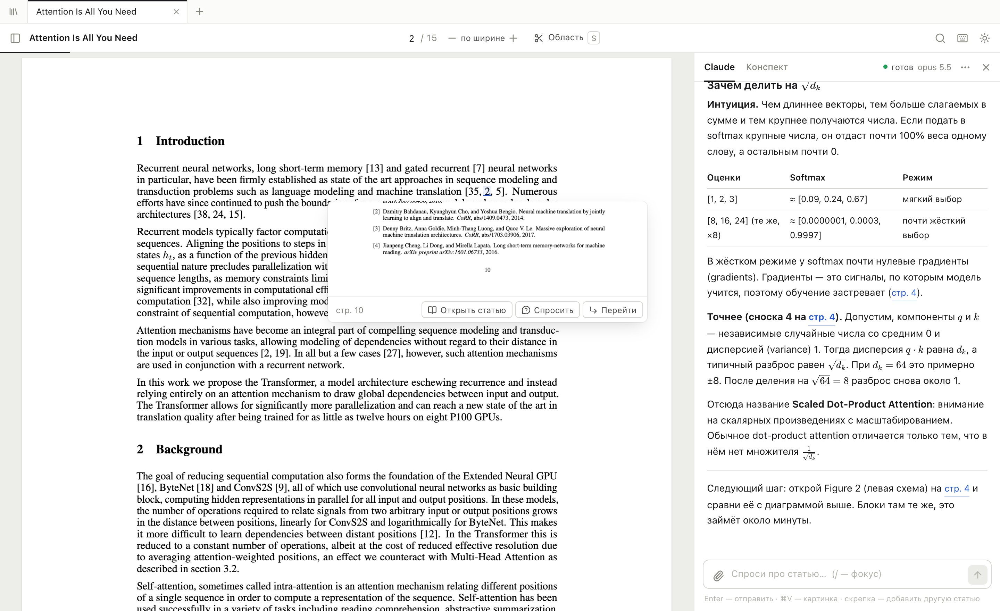
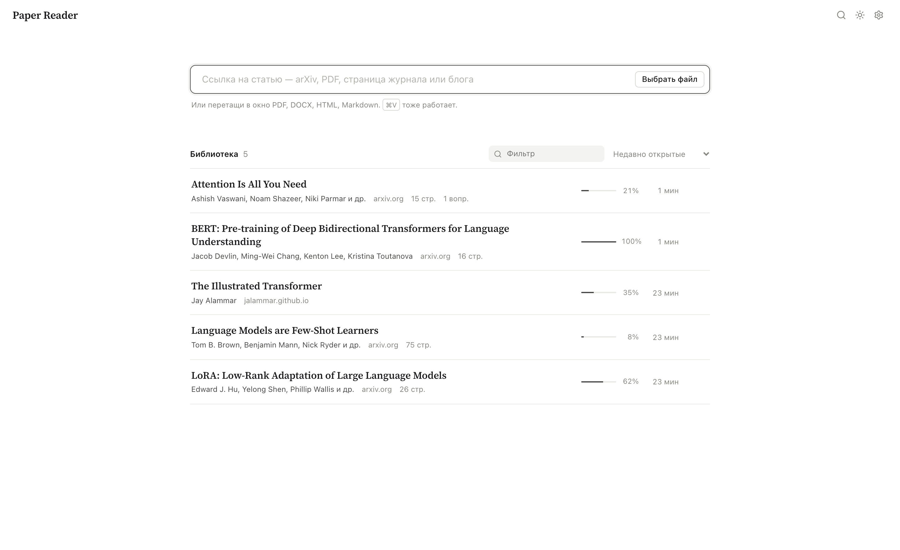
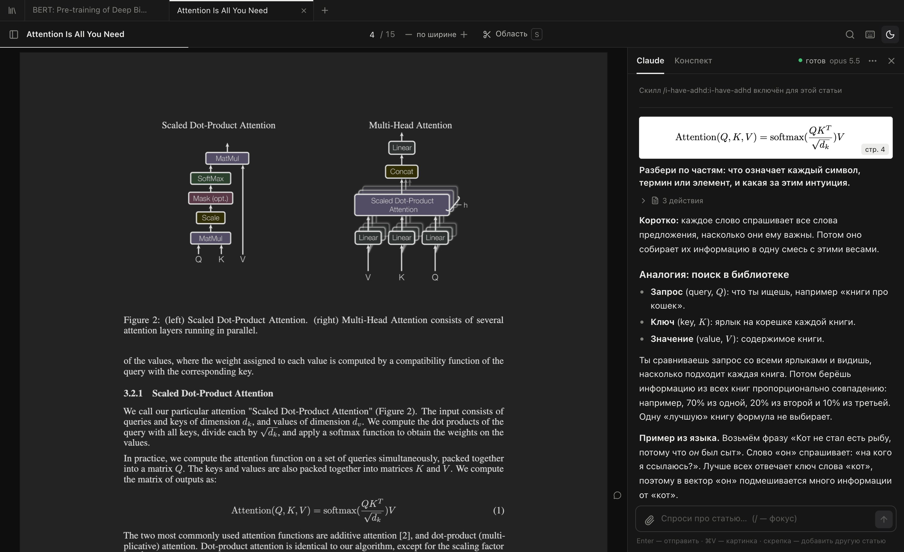

# Paper Reader

**A reader for research papers that you can ask questions while you read.** Select a confusing sentence or cut out a formula, figure or table, and ask Claude about it. Every paper gets its own Claude Code session, so Claude remembers what you have already asked and has the whole paper in front of it.

[Русская версия](README.ru.md)



- **No API key.** It runs your local [Claude Code](https://docs.claude.com/en/docs/claude-code) CLI, so it uses your Claude subscription.
- **Local.** Papers, highlights and chats stay on your machine. The server only listens on `127.0.0.1`.
- **Built for papers you don't understand yet.** Answers start with the intuition, then the precise meaning, and explain every symbol in a formula. Links in answers such as “p. 4” scroll the paper to that page.

> The interface is in Russian for now. Claude answers in the language you write in, and you can change its default answer language in settings. An English interface is planned.

## Features

**Open anything**
- PDF, DOCX, HTML, Markdown and TXT files: drag them in, pick them, or paste them.
- Links: arXiv (`/abs/` pages become PDFs, with title and authors from the arXiv API), OpenReview, ACL Anthology, bioRxiv/medRxiv, any journal page that publishes `citation_pdf_url`, and plain blog posts. Blog posts are saved for offline reading, images included.
- Opening the same link or file twice opens the paper you already have.

**Ask while reading**
- Select text and a toolbar appears: *Ask*, *Explain*, *Break down*, *Example*, plus four highlight colours.
- Press `S` and drag over a formula, figure or table. The region is rendered again at high resolution and sent to Claude as an image together with the text under it.
- Put several fragments and screenshots into one question, or paste an image from the clipboard.
- Attach another paper from your library to a question (for example, “how does this differ from LoRA?”). Claude reads both.
- A small marker in the page margin shows where you asked something. Click it to jump to that conversation.
- Answers stream in and render LaTeX, tables, code and Mermaid diagrams. While Claude works you can see what it is doing (“searching the text…”, “reading page 7”), and you can stop it at any time.
- The **Notes** tab: Claude keeps a summary of the paper and of your questions in `notes.md`.



**Navigate like in a real reader**
- Links inside the PDF work. Hover over a citation, “Figure 2” or “Table 1” to preview it, and click to jump there; *Back to reading* returns you to where you were. If the reference contains an arXiv ID or DOI, you can open the cited paper in one click.
- `⌘F` searches the whole paper, not just the pages on screen.
- The table of contents comes from the PDF's bookmarks or, if there are none, from its section headings.
- Tabs for several papers. `⌘K` jumps to any paper or opens a pasted link. A dot on a tab means Claude is still answering, or that an answer arrived while you were reading another paper.
- Reading position, zoom and highlights are remembered for each paper. Light, sepia and dark themes; in the dark theme the PDF is inverted too.
- Export highlights, notes and the whole Q&A to one Markdown file, which works with Obsidian.



| Library | Dark theme |
| --- | --- |
|  |  |

## Requirements

- macOS or Linux (developed and tested on macOS with Chrome)
- [Node.js](https://nodejs.org) 22 or newer
- [Claude Code](https://docs.claude.com/en/docs/claude-code), installed and logged in: run `claude` once and complete `/login`

## Quick start

```bash
git clone https://github.com/RazinAleksandr/paper-reader.git
cd paper-reader
./paper-reader
```

The script installs dependencies, builds the app, starts it and opens http://localhost:4317.

You can also open a paper directly:

```bash
./paper-reader https://arxiv.org/abs/1706.03762
./paper-reader ~/Downloads/paper.pdf
```

## Keyboard shortcuts

| Key | Action |
| --- | --- |
| `⌘K` | Open another paper or paste a link |
| `⌘F` | Search in the paper |
| `S` | Cut out a region as a screenshot |
| `A` / `E` | With a selection: add it to the question / ask Claude to explain it |
| `/` | Focus the question box |
| `⌘+` `⌘−` `⌘0` | Zoom; `0` fits the page width |
| `?` | All shortcuts |

## How the Claude sessions work

- Each paper runs its own long-lived `claude -p --input-format stream-json` process in the project folder. Sessions are named `📄 <paper title>`, so they also show up in `claude --resume`. The chat menu has *Copy terminal command* if you want to continue a session in the terminal.
- Claude gets the full extracted text of the paper, split by page (`paper.md`), and can open the original PDF to look at a figure.
- **Restricted permissions.** Claude can read files inside the project folder only, can write only the paper's `notes.md`, and may fetch pages only from research sites (arXiv, OpenReview, Semantic Scholar, Wikipedia, GitHub and similar). Text inside a paper therefore cannot send Claude after your personal files.
- Idle sessions go to sleep after 30 minutes, and at most 4 run at once. When you ask again, the session resumes with `--resume` and keeps its full context.
- **Start-up skills.** New sessions can receive slash commands first. The default is [`/i-have-adhd:i-have-adhd`](https://github.com/ayghri/i-have-adhd), which makes answers short and actionable. If the skill is not installed it is skipped. To install it:
  ```bash
  claude plugin marketplace add ayghri/i-have-adhd
  claude plugin install i-have-adhd@i-have-adhd
  ```
  You can change the start-up skills, the model, the effort level and the answer language in ⚙️ on the library page.

## Your data

Everything lives in `data/`, which is excluded from git:

```
data/
  config.json            settings
  papers/<id>/
    paper.pdf | article.html   original
    paper.md             extracted text that Claude reads
    chat.json            conversation
    highlights.json      highlights and notes
    notes.md             Claude's summary
    snippets/            screenshots you sent
```

Set `PAPER_READER_DATA=/path/to/folder` to keep the library somewhere else, for example in a synced folder.

| Variable | Default | |
| --- | --- | --- |
| `PORT` | `4317` | HTTP port |
| `PAPER_READER_DATA` | `./data` | Library location |
| `CLAUDE_BIN` | `claude` | Path to the Claude Code CLI |
| `PAPER_READER_MAX_SESSIONS` | `4` | Claude processes alive at once |
| `PAPER_READER_SESSION_CWD` | project folder | Working directory of the sessions |

## Troubleshooting

- **“Claude Code не найден” (Claude Code not found) banner.** Install Claude Code and make sure `claude` is on your `PATH`, or set `CLAUDE_BIN`.
- **The chat says Claude is not logged in.** Run `claude` in a terminal, complete `/login`, then ask again.
- **The port is busy.** Use `PORT=4400 ./paper-reader`.
- **A scanned PDF has no text.** Selection and search need a text layer, so run OCR first (for example `ocrmypdf in.pdf out.pdf`). Screenshots and questions about them still work without it.

## Development

```bash
npm install
npm run dev        # Vite on :5173 with hot reload + API on :4317
npm run typecheck
npm run build
```

- `server/`: Express API. `claude.ts` manages the sessions and the stream-json protocol; `importers.ts` handles files and links; `pdftext.ts` extracts text and the table of contents.
- `src/`: React app. `reader/` holds the PDF and HTML viewers, links, search and screenshots; `chat/` is the Claude panel; `workspace.ts` handles tabs and the live status of all sessions.

Issues and pull requests are welcome.

## License

[MIT](LICENSE)
