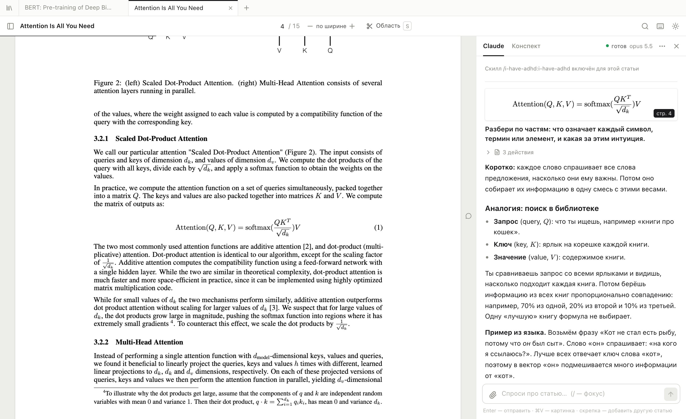
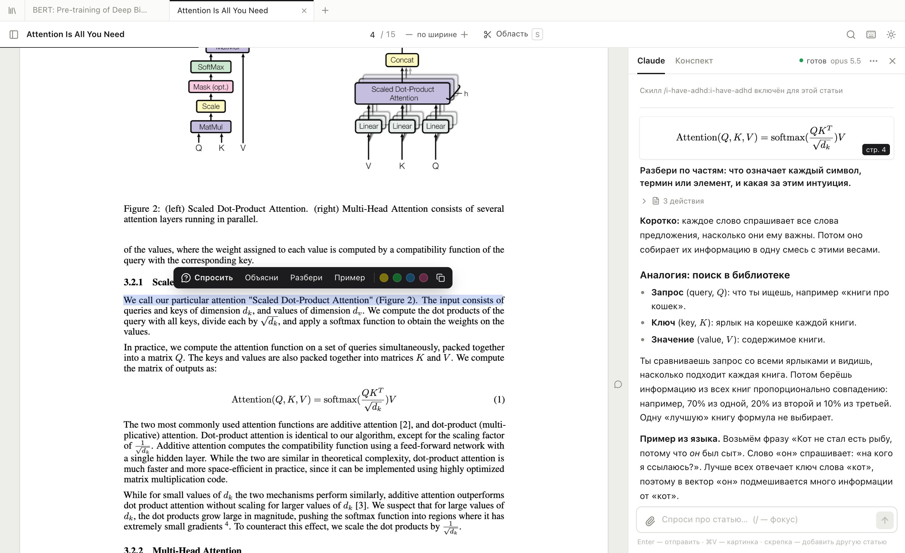
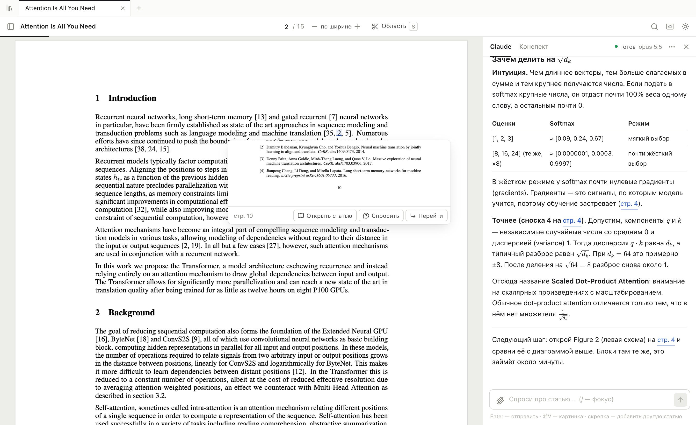

# Paper Reader

**Читалка научных статей, которой можно задавать вопросы прямо во время чтения.** Выделяешь непонятное предложение или вырезаешь формулу, рисунок или таблицу и спрашиваешь Claude. У каждой статьи своя сессия Claude Code, поэтому Claude помнит, о чём ты уже спрашивал, и видит статью целиком.

[English version](README.md)



- **Без API-ключа.** Работает через твой локальный [Claude Code](https://docs.claude.com/en/docs/claude-code), то есть по подписке Claude.
- **Всё локально.** Статьи, выделения и чаты остаются на твоём компьютере, сервер слушает только `127.0.0.1`.
- **Для статей, которые пока непонятны.** Ответ начинается с интуиции, потом идёт точный смысл, а каждый символ в формуле расшифровывается. Ссылки вида «стр. 4» в ответе прокручивают статью к нужной странице.

## Возможности

**Открыть что угодно**
- Файлы PDF, DOCX, HTML, Markdown, TXT: перетащи в окно, выбери или вставь через ⌘V.
- Ссылки: arXiv (страницы `/abs/` открываются как PDF, название и авторы берутся из API arXiv), OpenReview, ACL Anthology, bioRxiv/medRxiv, любые журналы с `citation_pdf_url` и обычные статьи в блогах. Статьи из блогов сохраняются для чтения офлайн вместе с картинками.
- Если открыть ту же ссылку или тот же файл повторно, откроется уже имеющаяся статья.

**Спрашивать во время чтения**
- Выдели текст, появится меню: *Спросить*, *Объясни*, *Разбери*, *Пример* и четыре цвета выделения.
- Нажми `S` и обведи формулу, рисунок или таблицу. Область заново рендерится в высоком качестве и уходит к Claude картинкой вместе с текстом под ней.
- В один вопрос можно собрать несколько фрагментов и скриншотов или вставить картинку из буфера.
- Скрепкой к вопросу прикрепляется другая статья из библиотеки («чем это отличается от LoRA?»). Claude прочитает обе.
- Там, где ты задавал вопрос, на поле страницы появляется значок. Клик по нему открывает этот разговор.
- Ответы приходят потоком и показывают LaTeX, таблицы, код и схемы Mermaid. Видно, что Claude делает («ищет в тексте…», «читает стр. 7»), и ответ можно остановить в любой момент.
- Вкладка **Конспект**: Claude ведёт `notes.md` по статье и твоим вопросам.



**Удобная навигация**
- Ссылки внутри PDF работают. При наведении на цитату, «Figure 2» или «Table 1» видно превью, по клику — переход, а кнопка «Вернуться к чтению» возвращает обратно. Если в источнике есть arXiv или DOI, цитируемую статью можно открыть одним кликом.
- `⌘F` ищет по всей статье, а не только по видимым страницам.
- Оглавление берётся из закладок PDF или, если их нет, собирается из заголовков разделов.
- Несколько статей во вкладках. `⌘K` — быстрый переход к любой статье или открытие ссылки. Точка на вкладке значит, что Claude ещё отвечает или пришёл новый ответ.
- Для каждой статьи запоминаются место чтения, масштаб и выделения. Темы светлая, сепия и тёмная; в тёмной инвертируется и PDF.
- Экспорт выделений, конспекта и всех вопросов с ответами в один Markdown-файл (подходит для Obsidian).



## Что нужно

- macOS или Linux (разрабатывалось и проверялось на macOS в Chrome)
- [Node.js](https://nodejs.org) 22 или новее
- [Claude Code](https://docs.claude.com/en/docs/claude-code), установленный и залогиненный: один раз запусти `claude` и выполни `/login`

## Запуск

```bash
git clone https://github.com/RazinAleksandr/paper-reader.git
cd paper-reader
./paper-reader
```

Скрипт поставит зависимости, соберёт приложение и откроет http://localhost:4317.

Статью можно открыть сразу:

```bash
./paper-reader https://arxiv.org/abs/1706.03762
./paper-reader ~/Downloads/paper.pdf
```

## Горячие клавиши

| Клавиша | Действие |
| --- | --- |
| `⌘K` | Открыть другую статью или вставить ссылку |
| `⌘F` | Поиск по статье |
| `S` | Вырезать область скриншотом |
| `A` / `E` | С выделением: добавить в вопрос / сразу попросить объяснить |
| `/` | Перейти к полю вопроса |
| `⌘+` `⌘−` `⌘0` | Масштаб; `0` — по ширине |
| `?` | Все клавиши |

## Как устроены сессии Claude

- Для каждой статьи в папке проекта работает свой процесс `claude -p --input-format stream-json`. Сессии называются `📄 <название статьи>` и видны в `claude --resume`. В меню чата есть «Скопировать команду для терминала», чтобы продолжить сессию в обычном Claude Code.
- Claude получает полный текст статьи с разбивкой по страницам (`paper.md`) и может открыть оригинальный PDF, чтобы посмотреть на рисунок.
- **Права ограничены.** Claude читает только файлы внутри папки проекта, пишет только `notes.md` этой статьи и открывает только научные сайты (arXiv, OpenReview, Semantic Scholar, Wikipedia, GitHub и т. п.). Так текст статьи не сможет отправить Claude за твоими личными файлами.
- Через 30 минут простоя сессия засыпает, одновременно живут не больше 4. Следующий вопрос продолжает её через `--resume` с полным контекстом.
- **Скиллы при старте.** Новая сессия первым делом получает слэш-команды. По умолчанию это [`/i-have-adhd:i-have-adhd`](https://github.com/ayghri/i-have-adhd): короткие ответы с понятным следующим шагом. Если скилл не установлен, он пропускается. Установить:
  ```bash
  claude plugin marketplace add ayghri/i-have-adhd
  claude plugin install i-have-adhd@i-have-adhd
  ```
  Скиллы, модель, effort и язык ответов меняются в ⚙️ на главной.

## Где лежат данные

Всё хранится в `data/` (папка не попадает в git): оригиналы статей, извлечённый текст, чаты, выделения, конспекты и скриншоты. Переменная `PAPER_READER_DATA=/путь` переносит библиотеку в другое место, например в синхронизируемую папку. Остальные настройки (`PORT`, `CLAUDE_BIN` и т. д.) описаны в [английском README](README.md#your-data).

## Если что-то не работает

- **Плашка «Claude Code не найден».** Установи Claude Code и проверь, что `claude` есть в `PATH`, или укажи путь в `CLAUDE_BIN`.
- **Чат пишет, что Claude не авторизован.** Запусти `claude` в терминале, выполни `/login` и спроси ещё раз.
- **Порт занят.** `PORT=4400 ./paper-reader`.
- **В скане PDF нет текста.** Для выделения и поиска нужен текстовый слой, сначала сделай OCR (например, `ocrmypdf in.pdf out.pdf`). Скриншоты и вопросы по ним работают и без него.

## Разработка

```bash
npm install
npm run dev        # Vite на :5173 с hot reload + API на :4317
npm run typecheck
npm run build
```

## Лицензия

[MIT](LICENSE)
