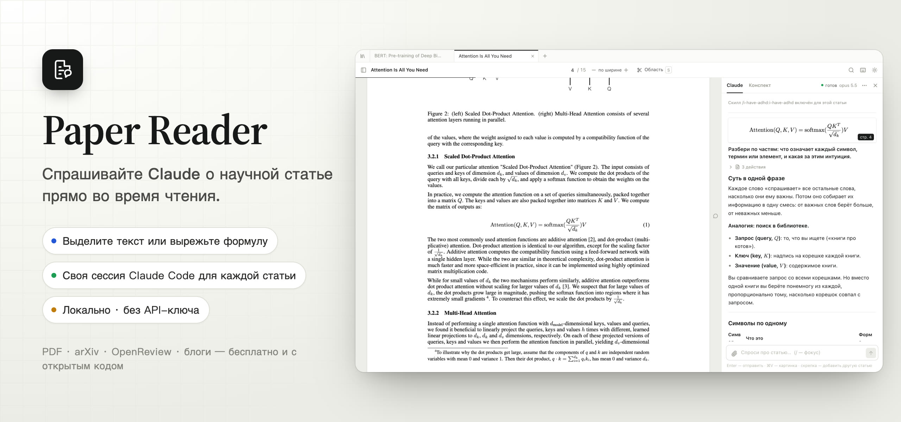
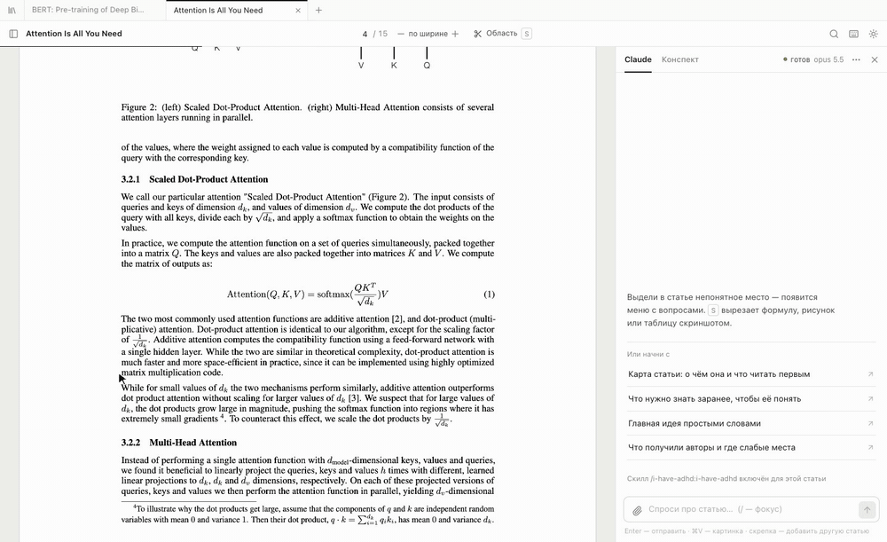
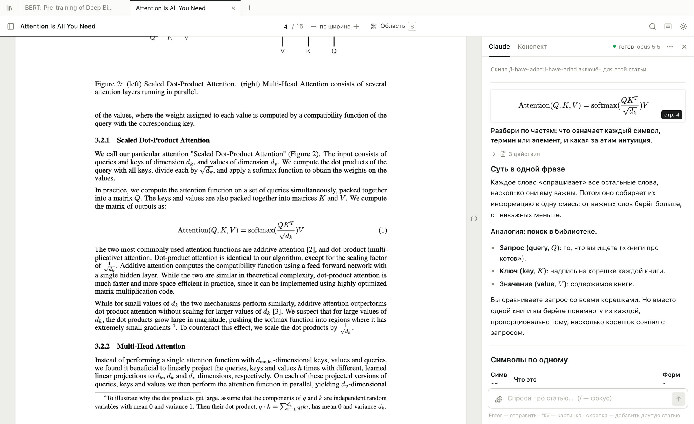
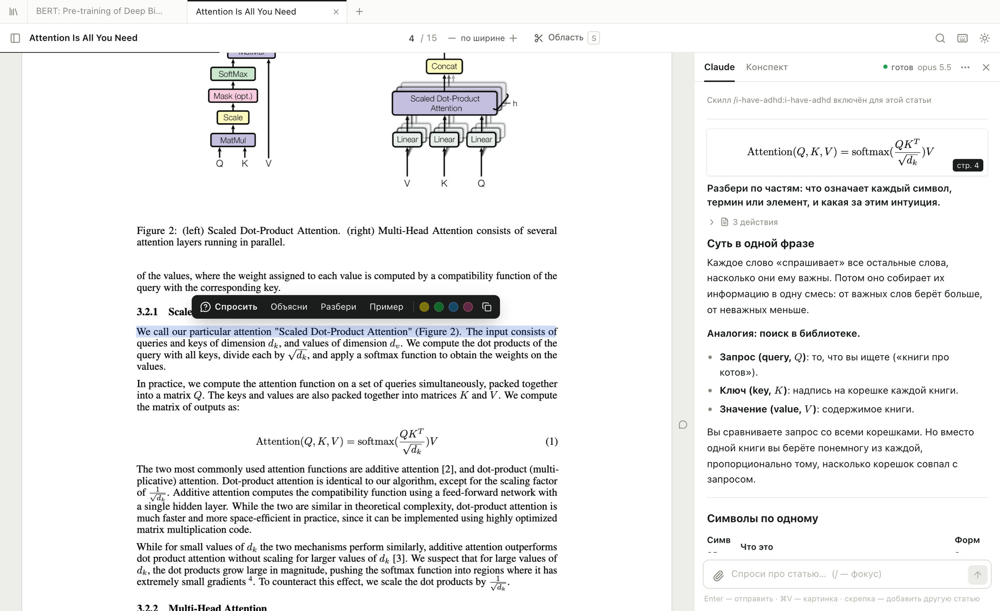
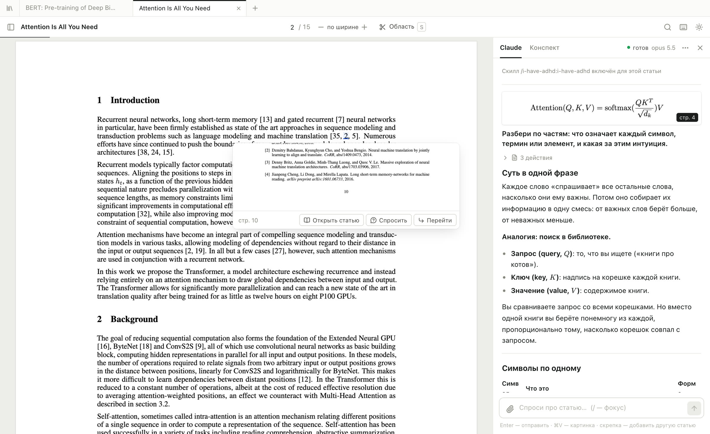
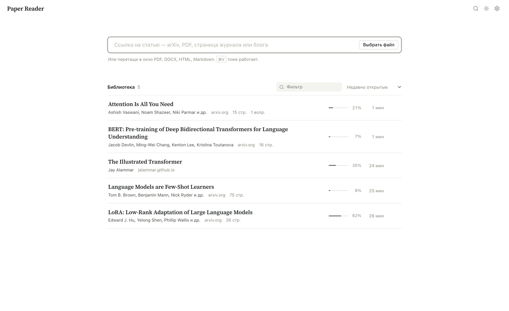
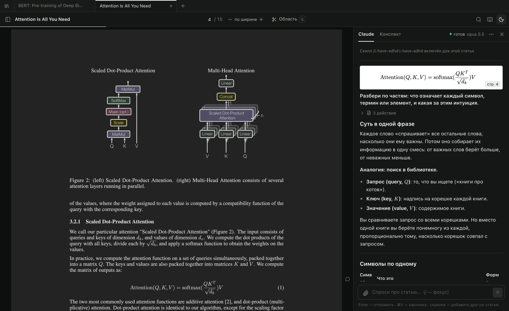

<p align="center">
  
</p>

<p align="center">
  <a href="README.md">English</a> · <b>Русский</b> · <a href="README.zh-CN.md">简体中文</a>
</p>

<p align="center">
  <a href="https://github.com/RazinAleksandr/paper-reader/releases/latest"></a>
  <a href="https://github.com/RazinAleksandr/paper-reader/actions/workflows/ci.yml"></a>
  
  
  
  <a href="LICENSE"></a>
</p>

<p align="center">
  Читалка научных статей, которой можно <b>задавать вопросы прямо во время чтения</b>.<br>
  Выделите непонятное предложение или вырежьте формулу, рисунок или таблицу — и спросите Claude.<br>
  У каждой статьи своя сессия Claude Code: Claude видит статью целиком и помнит, о чём вы уже спрашивали.
</p>

<p align="center">
  
</p>

---

## ⚡ Быстрый старт

```bash
git clone https://github.com/RazinAleksandr/paper-reader.git && cd paper-reader
./paper-reader                                   # установит, соберёт и откроет http://localhost:4317
./paper-reader https://arxiv.org/abs/1706.03762  # или сразу откройте статью
./paper-reader ~/Downloads/paper.pdf
```

Нужны [Node.js](https://nodejs.org) 22+ и [Claude Code](https://docs.claude.com/en/docs/claude-code) с выполненным входом (запустите `claude` и пройдите `/login`). Разрабатывалось и проверялось на macOS в Chrome; на Linux тоже должно работать.

## ✨ Чем хорош

|  |  |
|---|---|
| 🔑 **Без API-ключа** | Работает через ваш локальный Claude Code, то есть по подписке Claude. |
| 🔒 **Всё локально** | Статьи, выделения и чаты остаются на вашем компьютере. Сервер слушает только `127.0.0.1`. |
| 🧠 **Для статей, которые пока непонятны** | Ответ начинается с интуиции, потом идёт точный смысл, а каждый символ в формуле расшифровывается. |
| ✂️ **Спросить можно про что угодно на странице** | Выделите текст или нажмите `S` и вырежьте формулу, рисунок или таблицу — Claude получит её картинкой. |
| 🔗 **Как настоящая читалка** | Рабочие ссылки, превью цитат, поиск по всей статье, вкладки, темы. |
| 🌐 **Английский, русский, китайский** | Язык интерфейса меняется в ⚙️ Настройках. Claude отвечает на нём же, если не выбрать другой. |

## 📸 Подробнее

<p align="center">
  
</p>

| Выделите текст — появится меню | Наведите на цитату — увидите источник |
| --- | --- |
|  |  |
| **Библиотека** | **Тёмная тема** |
|  |  |

## 🧭 Возможности

**Открыть что угодно**
- Файлы PDF, DOCX, HTML, Markdown и TXT: перетащите в окно, выберите или вставьте через ⌘V.
- Ссылки: arXiv (страницы `/abs/` открываются как PDF, название и авторы берутся из API arXiv), OpenReview, ACL Anthology, bioRxiv/medRxiv, любые журналы с `citation_pdf_url` и обычные статьи в блогах. Статьи из блогов сохраняются для чтения офлайн вместе с картинками.
- Если открыть ту же ссылку или тот же файл повторно, откроется уже имеющаяся статья.

**Спрашивать во время чтения**
- Выделите текст — появится меню: *Спросить*, *Объясни*, *Разбери*, *Пример* и четыре цвета выделения.
- Нажмите `S` и обведите формулу, рисунок или таблицу. Область заново рендерится в высоком качестве и уходит к Claude картинкой вместе с текстом под ней.
- В один вопрос можно собрать несколько фрагментов и скриншотов или вставить картинку из буфера.
- Скрепкой к вопросу прикрепляется другая статья из библиотеки («чем это отличается от LoRA?»). Claude прочитает обе.
- Там, где вы задали вопрос, на поле страницы появляется значок. Клик по нему открывает этот разговор.
- Ответы приходят потоком и показывают LaTeX, таблицы, код и схемы Mermaid. Видно, что Claude делает («Ищет в тексте…», «Смотрит paper.pdf, стр. 7»), и ответ можно остановить в любой момент. Ссылки вида «стр. 4» прокручивают статью к нужной странице.
- Вкладка **Конспект**: Claude ведёт `notes.md` по статье и вашим вопросам.

**Удобная навигация**
- Ссылки внутри PDF работают. При наведении на цитату, «Figure 2» или «Table 1» видно превью, по клику — переход, а кнопка «Вернуться к чтению» возвращает обратно. Если в источнике есть arXiv ID или DOI, цитируемую статью можно открыть одним кликом.
- `⌘F` ищет по всей статье, а не только по видимым страницам.
- Оглавление берётся из закладок PDF или, если их нет, собирается из заголовков разделов.
- Несколько статей во вкладках. `⌘K` — быстрый переход к любой статье или открытие ссылки. Точка на вкладке значит, что Claude ещё отвечает или пришёл новый ответ.
- Для каждой статьи запоминаются место чтения, масштаб и выделения. Темы светлая, сепия и тёмная; в тёмной инвертируется и PDF.
- Экспорт выделений, конспекта и всех вопросов с ответами в один Markdown-файл (подходит для Obsidian).

## ⌨️ Горячие клавиши

| Клавиша | Действие |
| --- | --- |
| `⌘K` | Открыть другую статью или вставить ссылку |
| `⌘F` | Поиск по статье |
| `S` | Вырезать область скриншотом |
| `A` / `E` | При выделении: добавить в вопрос / попросить Claude объяснить |
| `/` | Перейти к полю вопроса |
| `⌘+` `⌘−` `⌘0` | Масштаб; `0` — по ширине страницы |
| `?` | Все сочетания клавиш |

## 🤖 Как устроены сессии Claude

- Для каждой статьи работает свой долгоживущий процесс `claude -p --input-format stream-json` в папке проекта. Сессии называются `📄 <название статьи>`, поэтому видны и в `claude --resume`. В меню чата есть *Скопировать команду для терминала*, чтобы продолжить сессию в терминале.
- Claude получает полный извлечённый текст статьи, разбитый по страницам (`paper.md`), и может открыть оригинальный PDF, чтобы посмотреть на рисунок.
- **Ограниченные права.** Claude читает файлы только внутри папки проекта, пишет только в `notes.md` своей статьи и открывает страницы только научных сайтов (arXiv, OpenReview, Semantic Scholar, Wikipedia, GitHub и подобных). Поэтому текст внутри статьи не может заставить Claude добраться до ваших личных файлов.
- **Язык ответов.** По умолчанию Claude отвечает на языке интерфейса; другой язык можно задать в ⚙️ Настройках. Эта настройка важнее, чем `language` в ваших собственных настройках Claude Code.
- Сессии без дела засыпают через 30 минут, одновременно работает не больше 4. При новом вопросе сессия продолжается через `--resume` с полным контекстом.
- **Скиллы при старте.** Новой сессии можно сначала отправить slash-команды. По умолчанию это [`/i-have-adhd:i-have-adhd`](https://github.com/ayghri/i-have-adhd): ответы становятся короткими и по делу. Если скилл не установлен, он пропускается. Установка:
  ```bash
  claude plugin marketplace add ayghri/i-have-adhd
  claude plugin install i-have-adhd@i-have-adhd
  ```
  Скиллы при старте, модель, усилие (effort) и язык ответов настраиваются в ⚙️ на странице библиотеки.

## 🗂️ Где лежат данные

Всё хранится в `data/`, эта папка не попадает в git:

```
data/
  config.json            настройки
  papers/<id>/
    paper.pdf | article.html   оригинал
    paper.md             извлечённый текст, который читает Claude
    chat.json            переписка
    highlights.json      выделения и заметки
    notes.md             конспект от Claude
    snippets/            отправленные скриншоты
```

| Переменная | По умолчанию | |
| --- | --- | --- |
| `PORT` | `4317` | HTTP-порт |
| `PAPER_READER_DATA` | `./data` | Где хранить библиотеку, например в синхронизируемой папке |
| `CLAUDE_BIN` | `claude` | Путь к Claude Code CLI |
| `PAPER_READER_MAX_SESSIONS` | `4` | Сколько процессов Claude работает одновременно |
| `PAPER_READER_SESSION_CWD` | папка проекта | Рабочая папка сессий |

## 🩺 Если что-то не работает

<details><summary><b>Плашка «Claude Code не найден»</b></summary>

Установите Claude Code и проверьте, что `claude` есть в `PATH`, или задайте `CLAUDE_BIN`.
</details>

<details><summary><b>В чате написано, что Claude не авторизован</b></summary>

Запустите `claude` в терминале, выполните `/login` и спросите снова.
</details>

<details><summary><b>Порт занят</b></summary>

`PORT=4400 ./paper-reader`
</details>

<details><summary><b>В отсканированном PDF нет текста</b></summary>

Выделению и поиску нужен текстовый слой, поэтому сначала распознайте текст (например, `ocrmypdf in.pdf out.pdf`). Скриншоты и вопросы по ним работают и без этого.
</details>

## 🛠️ Разработка

```bash
npm install
npm run dev        # Vite на :5173 с горячей перезагрузкой + API на :4317
npm run typecheck
npm run build
```

- `server/`: API на Express. `claude.ts` управляет сессиями и протоколом stream-json; `importers.ts` разбирает файлы и ссылки; `pdftext.ts` извлекает текст и оглавление.
- `src/`: приложение на React. В `reader/` просмотрщики PDF и HTML, ссылки, поиск и скриншоты; `chat/` — панель Claude; `workspace.ts` отвечает за вкладки и живой статус всех сессий.
- Переводы лежат прямо в коде: `t('English', 'Русский', '中文')` (`src/i18n.ts`, `shared/i18n.ts`).
- Картинки для README — настоящие снимки работающего приложения: `scripts/readme/` готовит демо-библиотеку, управляет Chrome через Playwright, пока Claude отвечает, и собирает скриншоты, GIF и баннер.

Issues и pull requests приветствуются.

## 📄 Лицензия

[MIT](LICENSE)
