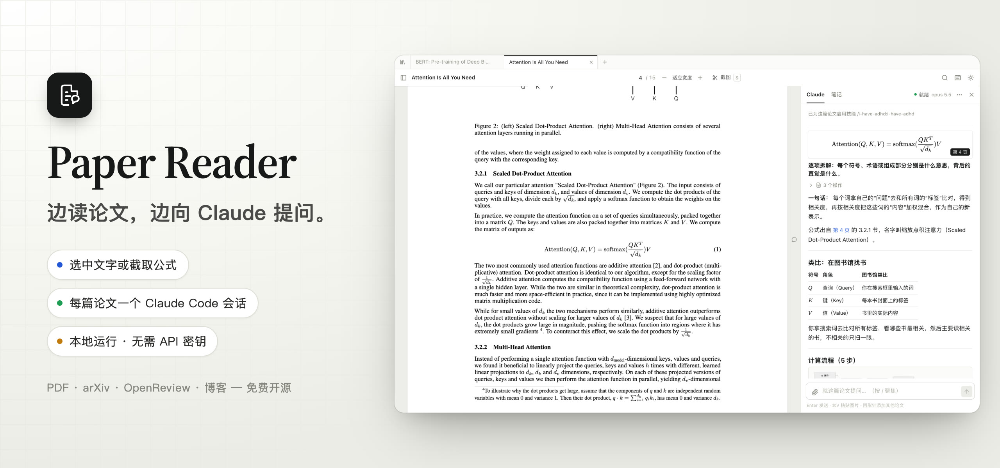
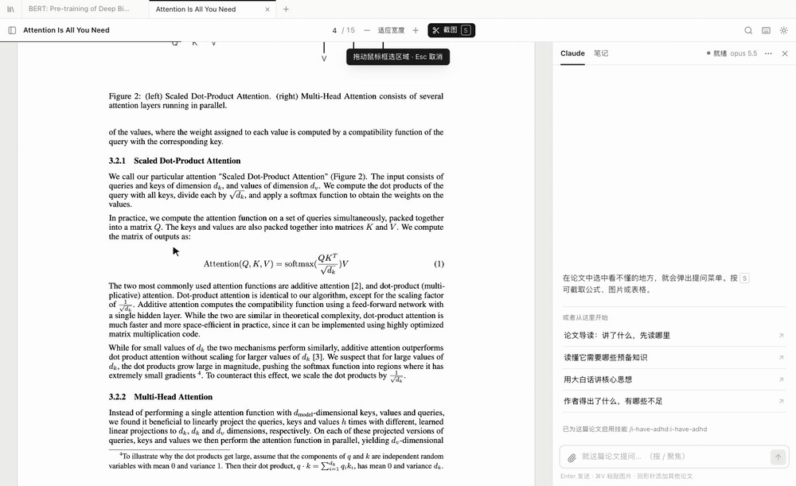
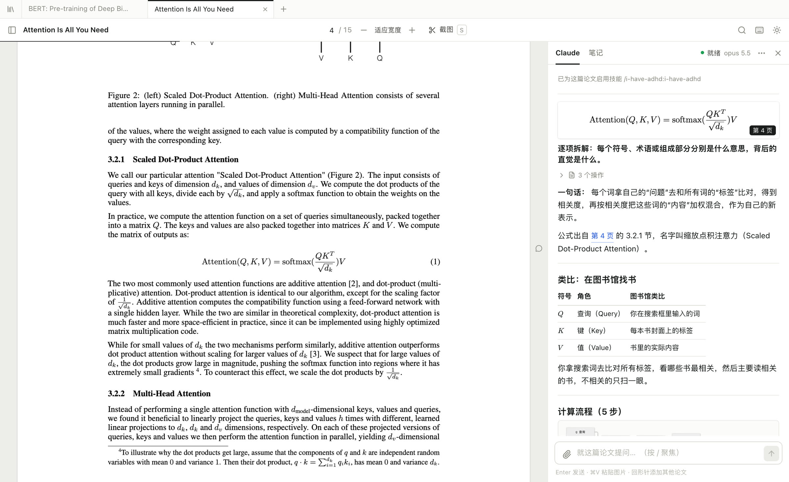
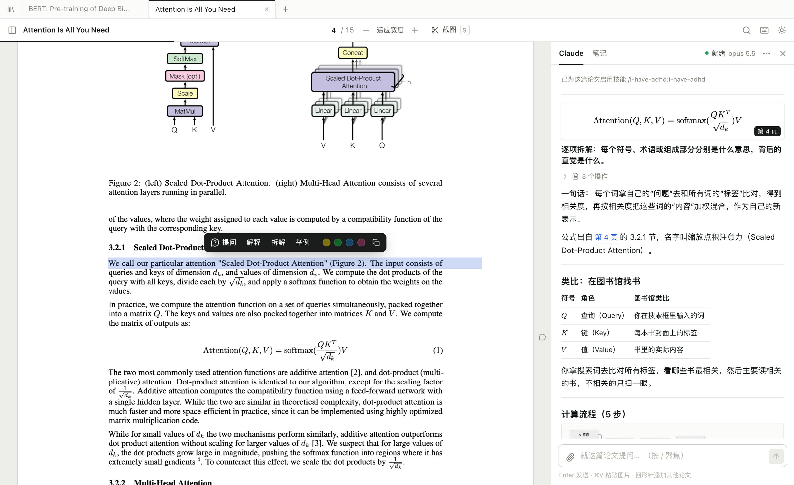
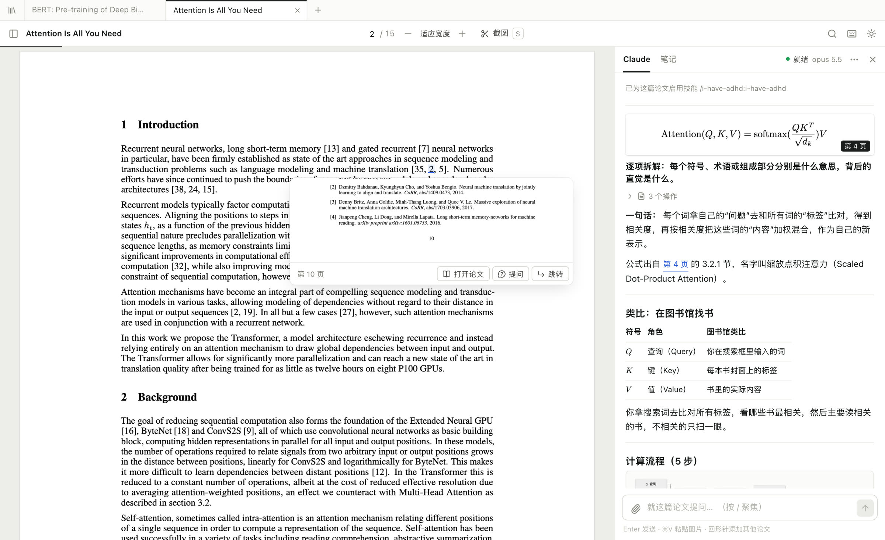
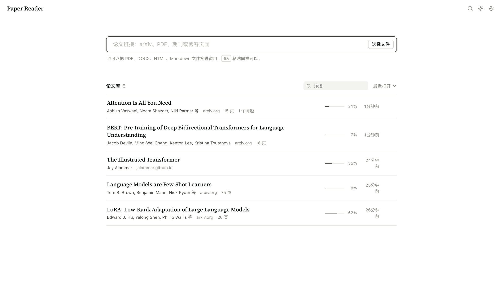
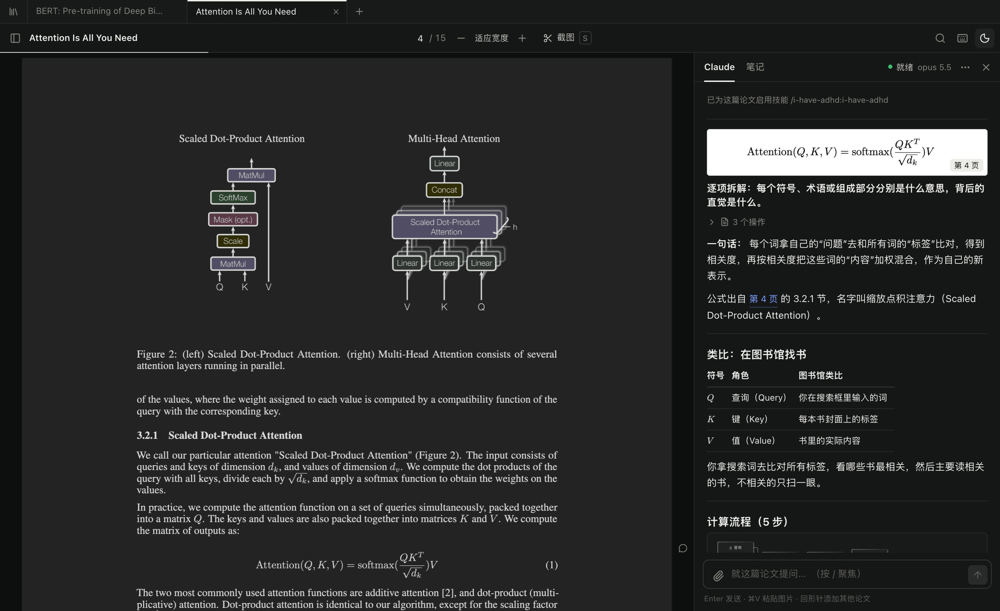

<p align="center">
  
</p>

<p align="center">
  <a href="README.md">English</a> · <a href="README.ru.md">Русский</a> · <b>简体中文</b>
</p>

<p align="center">
  <a href="https://github.com/RazinAleksandr/paper-reader/releases/latest"></a>
  <a href="https://github.com/RazinAleksandr/paper-reader/actions/workflows/ci.yml"></a>
  
  
  
  <a href="LICENSE"></a>
</p>

<p align="center">
  一个<b>边读边问</b>的科研论文阅读器。<br>
  选中一句看不懂的话，或截取一个公式、图或表，直接问 Claude。<br>
  每篇论文都有自己的 Claude Code 会话：Claude 能看到整篇论文，也记得你问过什么。
</p>

<p align="center">
  
</p>

---

## ⚡ 快速开始

```bash
git clone https://github.com/RazinAleksandr/paper-reader.git && cd paper-reader
./paper-reader                                   # 安装、构建并打开 http://localhost:4317
./paper-reader https://arxiv.org/abs/1706.03762  # 或直接打开一篇论文
./paper-reader ~/Downloads/paper.pdf
```

需要 [Node.js](https://nodejs.org) 22+ 和已登录的 [Claude Code](https://docs.claude.com/en/docs/claude-code)（运行一次 `claude` 并完成 `/login`）。在 macOS + Chrome 上开发和测试；Linux 应该也能用。

## ✨ 亮点

|  |  |
|---|---|
| 🔑 **无需 API 密钥** | 调用你本地的 Claude Code，使用你的 Claude 订阅。 |
| 🔒 **本地运行** | 论文、标注和对话都留在你的电脑上。服务器只监听 `127.0.0.1`。 |
| 🧠 **专为还没读懂的论文** | 回答先讲直觉，再讲准确含义，并解释公式里的每一个符号。 |
| ✂️ **页面上什么都能问** | 选中文字，或按 `S` 截取公式、图或表——它会以图片形式发给 Claude。 |
| 🔗 **真正的阅读器体验** | 可点击的链接、引用预览、全文搜索、标签页、主题。 |
| 🌐 **英文、俄文、中文** | 在 ⚙️ 设置中切换界面语言。Claude 默认用同一种语言回答，也可以另选。 |

## 📸 细看

<p align="center">
  
</p>

| 选中文字，弹出工具栏 | 悬停引用，预览出处 |
| --- | --- |
|  |  |
| **论文库** | **深色主题** |
|  |  |

## 🧭 功能

**什么都能打开**
- PDF、DOCX、HTML、Markdown 和 TXT 文件：拖进窗口、选择文件或用 ⌘V 粘贴。
- 链接：arXiv（`/abs/` 页面会以 PDF 打开，标题和作者取自 arXiv API）、OpenReview、ACL Anthology、bioRxiv/medRxiv、任何提供 `citation_pdf_url` 的期刊页面，以及普通博客文章。博客文章连同图片一起保存，可离线阅读。
- 再次打开同一个链接或文件，会直接打开已有的那篇。

**边读边问**
- 选中文字会出现工具栏：*提问*、*解释*、*拆解*、*举例*，以及四种高亮颜色。
- 按 `S` 框选公式、图或表。该区域会以高分辨率重新渲染，连同其下的文字一起作为图片发给 Claude。
- 一个问题里可以放多个片段和截图，也可以粘贴剪贴板里的图片。
- 用回形针把库里的另一篇论文附到问题上（“这和 LoRA 有什么区别？”）。Claude 会两篇都读。
- 你提过问的位置，页边会出现一个小标记。点击即可跳到那段对话。
- 回答以流式显示，支持 LaTeX、表格、代码和 Mermaid 图。Claude 工作时你能看到它在做什么（“正在文中搜索…”“正在查看 paper.pdf，第 7 页”），也可以随时停止。“第 4 页”这样的链接会把论文滚动到对应页。
- **笔记**标签页：Claude 在 `notes.md` 里整理论文摘要和你的提问。

**像真正的阅读器一样导航**
- PDF 内的链接可以点击。悬停在引用、“Figure 2” 或 “Table 1” 上可预览，点击跳转；*返回阅读位置*带你回到原处。如果参考文献里有 arXiv ID 或 DOI，一键即可打开被引论文。
- `⌘F` 搜索整篇论文，而不只是屏幕上的几页。
- 目录取自 PDF 书签；没有书签时，从章节标题生成。
- 多篇论文用标签页切换。`⌘K` 跳到任意论文或打开粘贴的链接。标签上的圆点表示 Claude 还在回答，或者在你读别的论文时收到了新回答。
- 每篇论文的阅读位置、缩放和高亮都会被记住。浅色、棕褐和深色三种主题；深色主题下 PDF 也会反色。
- 把高亮、笔记和全部问答导出为一个 Markdown 文件，可直接用于 Obsidian。

## ⌨️ 快捷键

| 按键 | 作用 |
| --- | --- |
| `⌘K` | 打开另一篇论文或粘贴链接 |
| `⌘F` | 在论文中搜索 |
| `S` | 截取一块区域 |
| `A` / `E` | 选中文字时：加入问题 / 让 Claude 解释 |
| `/` | 聚焦提问框 |
| `⌘+` `⌘−` `⌘0` | 缩放；`0` 为适应页宽 |
| `?` | 全部快捷键 |

## 🤖 Claude 会话如何工作

- 每篇论文在项目文件夹中运行自己的长驻进程 `claude -p --input-format stream-json`。会话名为 `📄 <论文标题>`，因此也会出现在 `claude --resume` 里。聊天菜单中的*复制终端命令*可以让你在终端里继续这个会话。
- Claude 拿到按页拆分的论文全文（`paper.md`），需要看图时还能打开原始 PDF。
- **受限权限。** Claude 只能读取项目文件夹内的文件，只能写入本论文的 `notes.md`，只能访问科研类网站（arXiv、OpenReview、Semantic Scholar、Wikipedia、GitHub 等）。因此论文里的文字无法诱导 Claude 去读你的私人文件。
- **回答语言。** 默认与界面语言一致；可在 ⚙️ 设置中另选。此设置优先于你自己 Claude Code 设置里的 `language`。
- 空闲会话 30 分钟后休眠，最多同时运行 4 个。再次提问时会用 `--resume` 恢复，完整保留上下文。
- **启动技能。** 新会话可以先收到斜杠命令。默认是 [`/i-have-adhd:i-have-adhd`](https://github.com/ayghri/i-have-adhd)，让回答简短、可操作；未安装时会跳过。安装方法：
  ```bash
  claude plugin marketplace add ayghri/i-have-adhd
  claude plugin install i-have-adhd@i-have-adhd
  ```
  启动技能、模型、努力程度（effort）和回答语言都在论文库页面的 ⚙️ 设置里。

## 🗂️ 你的数据

所有内容都在 `data/` 中，不会进入 git：

```
data/
  config.json            设置
  papers/<id>/
    paper.pdf | article.html   原文
    paper.md             Claude 读取的提取文本
    chat.json            对话
    highlights.json      高亮和批注
    notes.md             Claude 整理的笔记
    snippets/            你发送的截图
```

| 变量 | 默认值 | |
| --- | --- | --- |
| `PORT` | `4317` | HTTP 端口 |
| `PAPER_READER_DATA` | `./data` | 论文库位置，例如同步文件夹 |
| `CLAUDE_BIN` | `claude` | Claude Code CLI 路径 |
| `PAPER_READER_MAX_SESSIONS` | `4` | 同时运行的 Claude 进程数 |
| `PAPER_READER_SESSION_CWD` | 项目文件夹 | 会话的工作目录 |

## 🩺 故障排除

<details><summary><b>出现“未找到 Claude Code”提示</b></summary>

安装 Claude Code，并确认 `claude` 在 `PATH` 中，或设置 `CLAUDE_BIN`。
</details>

<details><summary><b>聊天提示 Claude 未登录</b></summary>

在终端运行 `claude`，完成 `/login`，然后再问一次。
</details>

<details><summary><b>端口被占用</b></summary>

`PORT=4400 ./paper-reader`
</details>

<details><summary><b>扫描版 PDF 没有文字</b></summary>

选中和搜索需要文字层，请先做 OCR（例如 `ocrmypdf in.pdf out.pdf`）。截图和针对截图的提问不受影响。
</details>

## 🛠️ 开发

```bash
npm install
npm run dev        # Vite 在 :5173（热重载）+ API 在 :4317
npm run typecheck
npm run build
```

- `server/`：Express API。`claude.ts` 管理会话和 stream-json 协议；`importers.ts` 处理文件和链接；`pdftext.ts` 提取文本和目录。
- `src/`：React 应用。`reader/` 包含 PDF 和 HTML 查看器、链接、搜索和截图；`chat/` 是 Claude 面板；`workspace.ts` 负责标签页和所有会话的实时状态。
- 翻译直接写在代码里：`t('English', 'Русский', '中文')`（`src/i18n.ts`、`shared/i18n.ts`）。
- README 中的图片都是运行中应用的真实截图：`scripts/readme/` 准备演示论文库，在 Claude 作答时用 Playwright 驱动 Chrome，并生成截图、GIF 和横幅。

欢迎提交 Issue 和 Pull Request。

## 📄 许可证

[MIT](LICENSE)
